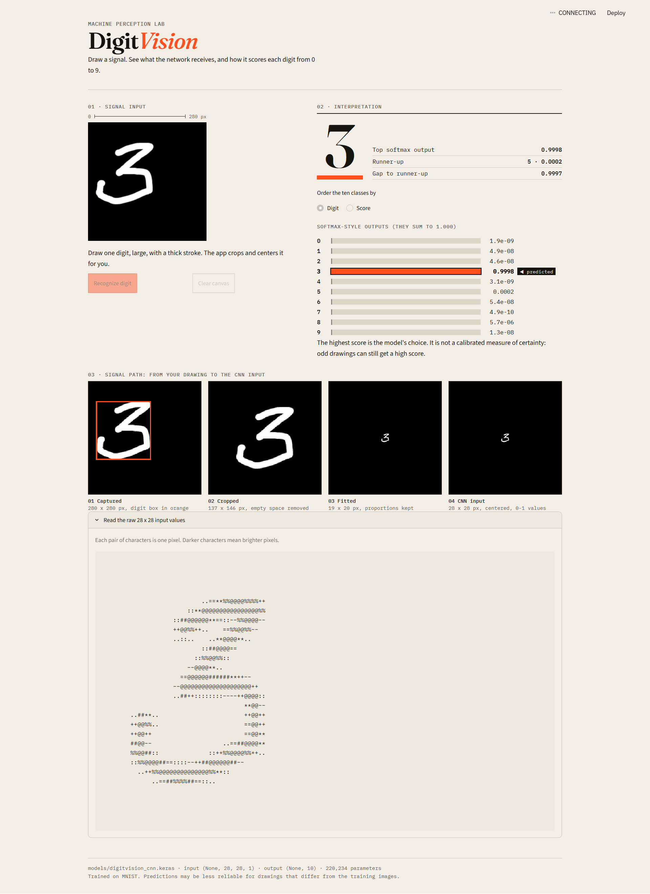

# DIGITVISION

### A small vision lab for handwritten digit recognition.

DigitVision is an interactive handwritten digit recognition application built with **Python, TensorFlow/Keras, and Streamlit**. A convolutional neural network (CNN) trained on the MNIST dataset predicts digits from user-drawn images and exposes the model's output scores for further inspection.

The project brings together the complete learning loop: image preprocessing, CNN architecture, model training, evaluation, and an interactive inference interface.



<p align="center">
  <strong>COMPUTER VISION</strong> &nbsp; / &nbsp; <strong>CONVOLUTIONAL NEURAL NETWORKS</strong> &nbsp; / &nbsp; <strong>MNIST</strong>
</p>

---

## 01 / Project overview

DigitVision explores a deceptively simple computer vision problem:

**How can a neural network turn pixels into a digit prediction?**

The application lets users draw a digit, processes the drawing into a model-compatible image, and displays the predicted class alongside its confidence scores. Behind the interface is a CNN that learns visual patterns from the MNIST dataset.

| Component | Implementation |
|---|---|
| Task | Handwritten digit classification |
| Dataset | MNIST |
| Model | Convolutional Neural Network |
| Deep learning framework | TensorFlow / Keras |
| Application interface | Streamlit |
| Drawing interface | Streamlit Drawable Canvas |
| Input format | Grayscale, 28 × 28 pixels, one channel |
| Output | Scores for ten digit classes, 0–9 |

## 02 / Inside the interface

The interface is designed to make model inference visible rather than treating prediction as a black box.

- **Draw a digit** on the interactive canvas.
- **Preprocess the drawing** into a format suitable for the trained model.
- **Predict the class** using the saved CNN.
- **Inspect class scores** to compare the predicted digit with alternative predictions.
- **Review the processed image** to understand what the model receives.

The application also displays softmax-style class scores. These describe the model's relative output across the ten classes; they should not automatically be interpreted as calibrated probabilities or a guarantee that a prediction is correct.

## 03 / The model

DigitVision uses a sequential CNN with two convolution-and-pooling stages, followed by fully connected classification layers.

```text
Input image
28 × 28 × 1
     │
     ▼
Conv2D · 32 filters · 3 × 3 · ReLU
     │
     ▼
MaxPooling2D · 2 × 2
     │
     ▼
Conv2D · 64 filters · 3 × 3 · ReLU
     │
     ▼
MaxPooling2D · 2 × 2
     │
     ▼
Flatten
     │
     ▼
Dense · 64 units · ReLU
     │
     ▼
Dense · 10 units · Softmax
     │
     ▼
Digit scores · 0–9
```

### Architecture at a glance

| Layer | Configuration | Output shape |
|---|---|---|
| Input | Grayscale image | 28 × 28 × 1 |
| Convolution | 32 filters, 3 × 3, ReLU, same padding | 28 × 28 × 32 |
| Max pooling | 2 × 2 | 14 × 14 × 32 |
| Convolution | 64 filters, 3 × 3, ReLU, same padding | 14 × 14 × 64 |
| Max pooling | 2 × 2 | 7 × 7 × 64 |
| Flatten | Convert feature maps into a vector | 3,136 features |
| Dense | 64 units, ReLU | 64 |
| Output | 10 units, softmax | 10 scores |

### Why these layers?

**Convolution** learns local visual patterns from the image. Early features may represent edges and simple strokes; deeper features can combine them into more useful digit patterns.

**ReLU** introduces non-linearity, allowing the network to learn more complex relationships than a purely linear model.

**Max pooling** reduces the spatial dimensions of feature maps while retaining strong activations.

**Flatten** converts the final feature maps into a one-dimensional vector for classification.

**Dense layers** combine learned features to produce scores for the ten possible digit classes.

**Softmax** converts the final layer's logits into a normalized distribution of output scores.

## 04 / Training and data

The model is trained on **MNIST**, a dataset of grayscale images of handwritten digits.

| Dataset split | Images | Purpose |
|---|---:|---|
| Training | 54,000 | Learn model parameters |
| Validation | 6,000 | Monitor training performance |
| Test | 10,000 | Evaluate generalization |

The original MNIST training set contains 60,000 images. It is split into 54,000 training examples and 6,000 validation examples; the separate test set contains 10,000 examples.

### Training configuration

| Setting | Value |
|---|---|
| Image normalization | Pixel values divided by 255 |
| Input representation | 28 × 28 × 1 |
| Optimizer | Adam |
| Loss function | Sparse categorical cross-entropy |
| Batch size | 128 |
| Epochs | 5 |

The image pixels are converted to floating-point values and normalized to the range 0–1. A channel dimension is added to match the CNN's expected input shape.

Sparse categorical cross-entropy is appropriate because each image has one integer class label, from 0 to 9.

## 05 / From drawing to prediction

A model trained on MNIST expects a consistent image format. A freehand canvas drawing does not automatically match that format.

DigitVision therefore applies a preprocessing pipeline before inference:

```text
User drawing
     │
     ▼
Extract the drawn image
     │
     ▼
Convert to grayscale
     │
     ▼
Threshold the strokes
     │
     ▼
Crop the digit's bounding box
     │
     ▼
Resize while preserving aspect ratio
     │
     ▼
Center on a 28 × 28 black canvas
     │
     ▼
Normalize pixel values
     │
     ▼
CNN inference
     │
     ▼
Predicted digit + class scores
```

The digit is resized to fit within a 20 × 20 region while preserving its aspect ratio, then centered on a 28 × 28 canvas. This is intended to make user drawings more compatible with the MNIST-style input used during training.

**Why preprocessing matters:** even a well-trained classifier can produce poor predictions when the input's polarity, scale, position, or shape differs from the examples it learned from.

## 06 / Evaluation

Model performance should be measured on the held-out MNIST test set, separately from the training and validation data.

DigitVision includes an evaluation script and a confusion-matrix report to help inspect classification performance beyond a single accuracy number.

**Evaluation artifacts**

- `src/evaluate.py` — evaluates the saved model on the test set and reports classification metrics.
- `reports/confusion_matrix.png` — visualizes correct predictions and patterns of confusion between digit classes.
- `src/predict.py` — provides a separate prediction workflow for a selected MNIST test example.

The confusion matrix is especially useful for identifying which digits the model tends to mistake for one another. Per-class precision and recall offer additional insight that overall accuracy alone cannot provide.

No benchmark number is presented here as a current result. Run the evaluation script against the current saved model before adding a performance claim to this README.

## 07 / Technology

| Technology | Role |
|---|---|
| Python | Core programming language |
| TensorFlow / Keras | CNN construction, training, and inference |
| NumPy | Numerical and array operations |
| Streamlit | Interactive application |
| Streamlit Drawable Canvas | User drawing input |
| Matplotlib | Evaluation visualization |
| MNIST | Training and test dataset |

The exact installed dependency versions are maintained in `requirements.txt`.

## 08 / Run locally

### Requirements

- Python compatible with the project's pinned dependencies
- `pip`
- Git, if cloning the repository

### 1. Get the project

If you have cloned the repository, open a terminal in the project directory.

```powershell
cd DigitVision
```

### 2. Create a virtual environment

On Windows PowerShell:

```powershell
py -m venv digitvision_env
.\digitvision_env\Scripts\Activate.ps1
```

If PowerShell blocks activation, use the Python executable directly or adjust the activation policy according to your environment's security requirements.

### 3. Install dependencies

```powershell
python -m pip install --upgrade pip
pip install -r requirements.txt
```

### 4. Launch the application

```powershell
streamlit run app.py
```

Streamlit will provide a local URL in the terminal. Open that address in your browser, draw a digit, and inspect the resulting prediction.

### 5. Evaluate the model

From the project root:

```powershell
python src/evaluate.py
```

This runs the evaluation workflow and produces the reported metrics and confusion-matrix visualization, subject to the script's configured output paths.

## 09 / Repository map

```text
DigitVision/
│
├── app.py                         # Interactive Streamlit application
├── lesson_02_mnist.py              # MNIST learning and training script
├── requirements.txt                # Project dependencies
├── README.md                       # Project documentation
│
├── assets/
│   └── UI.png                      # Application interface screenshot
│
├── models/
│   └── digitvision_cnn.keras       # Saved trained CNN
│
├── notebooks/
│   └── digitvision_cnn.ipynb       # CNN development notebook
│
├── reports/
│   └── confusion_matrix.png        # Model evaluation visualization
│
├── src/
│   ├── evaluate.py                 # Test-set evaluation
│   └── predict.py                  # Sample prediction workflow
│
├── .streamlit/
│   └── config.toml                 # Streamlit theme configuration
│
└── .gitignore                      # Files excluded from version control
```

The virtual environment directory, `digitvision_env/`, is local development infrastructure and should not be committed to version control.

## 10 / What this project demonstrates

DigitVision is both an applied computer vision project and a practical exercise in understanding the model lifecycle.

- Building a CNN with TensorFlow/Keras.
- Understanding convolution, pooling, feature maps, flattening, and classification.
- Preparing image data for neural network input.
- Training with validation data and evaluating on a separate test set.
- Interpreting class scores and confusion matrices.
- Connecting a trained model to an interactive Streamlit interface.
- Handling the preprocessing differences between a dataset image and a user-drawn image.

## 11 / Possible next steps

Potential improvements include:

- Compare predictions before and after preprocessing to better understand input sensitivity.
- Add examples of correct and incorrect predictions from the test set.
- Track training and validation loss across epochs.
- Evaluate performance on handwritten digits drawn by people outside the MNIST dataset.
- Investigate calibration before presenting model scores as reliable confidence estimates.
- Publish a hosted demo once deployment is configured and verified.

---

## Project status

DigitVision includes a trained CNN, an interactive drawing interface, and model evaluation utilities. A public demo URL and live deployment status are intentionally omitted until they are confirmed.

**DigitVision — from pixels to predictions.**